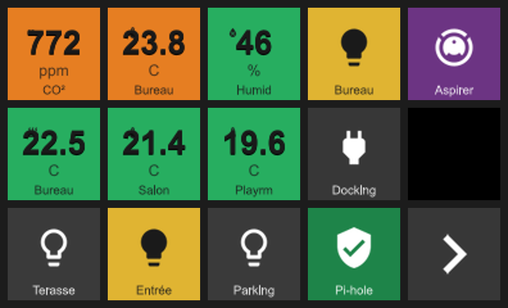

# Stream Deck Pilot

A headless .NET service that drives Elgato Stream Deck devices over USB from inside a
Docker container. It renders button tiles that react to MQTT events (Home Assistant or any
MQTT 3.1.1 broker) and is configured entirely over a REST API. There is no UI and no database:
configuration is JSON files on a mounted volume, and the service is controlled by HTTP calls and
driven by MQTT messages. It is intended to run unattended on a Linux mini-server behind a reverse
proxy that terminates HTTPS.

This README is the operational glue layer. For deeper detail see:

- `streamdeck-service-spec.md` — authoritative architecture and design brief
- `CLAUDE.md` — architecture summary
- `docs/api-guide.md` — full REST API reference (request/response shapes, worked examples)
- `docs/icon-vocabulary.md` — icon library and `builtin:<name>` naming
- `docs/design/key-rendering-redesign.md` and `docs/readability-design-report.md` — rendering and typography

---

## 1. How it works

The service runs three independent loops inside one process.

```
   USB device                MQTT broker                  REST clients
       |                          |                            |
  [Device supervisor]      [MQTT client + pipeline]      [ASP.NET minimal API]
   enumerate / poll          subscribe wildcard            read/write config
   connect / reconnect       extract -> rule -> render     manage catalogue
       |                          |                            |
       +--------------+-----------+-------------+--------------+
                      |   in-memory DESIRED STATE (per button) |
                      +-----------------------------------------+
                                   |
                        best-effort projection to hardware
```

- **Device supervision** enumerates and connects Stream Deck hardware, runs a per-device state
  machine (`Disconnected -> Connecting -> Connected -> Faulted -> reconnecting`), and supervises
  multiple devices independently.
- **MQTT pipeline** holds a single wildcard subscription. For each inbound message it runs a fixed
  pipeline: `receive -> extract field -> evaluate rules -> format value -> compose label -> render`.
- **REST config surface** is the only way to read/write configuration. Config writes are validated
  against the device catalogue before being persisted.

The service maintains the intended ("desired") state of every button in memory at all times.
Rendering to physical hardware is a best-effort projection of that state. A device disconnect is a
non-event; on reconnect the service re-renders every button from desired state. The broker being
unreachable is a degraded state, not a crash — the API stays up regardless.

---

## 2. Prerequisites

- **Docker** on a host that supports USB/HID device passthrough — a Linux host, or Docker on Windows
  via WSL2 with the HID device attached to the WSL distro.
- **Elgato Stream Deck** — any model supported by StreamDeckSharp (Original, MK.2, XL, Mini, and
  variants). The service reads key geometry from the device at discovery time (`CountX × CountY`), so
  different grid sizes work without config changes. PID `0x00A5` (MK.2 Scissor Switch revision,
  missing from StreamDeckSharp 6.1.0) is registered at startup automatically.
- **MQTT broker** speaking MQTT 3.1.1. The integration tests run against Mosquitto (`eclipse-mosquitto:2`);
  any compliant broker works. RabbitMQ's MQTT plugin does not deliver retained messages to wildcard
  subscriptions, so tiles fed by retained topics stay empty until the next update there.
- The container already installs `libhidapi-libusb0`, `libusb-1.0-0`, and `fonts-dejavu-core`
  (see the Dockerfile) — nothing extra to install on the host beyond Docker itself.

To find the right HID node on the host, attach the device and look for `/dev/hidrawN` (the supervisor
opens the Stream Deck through hidraw).

---

## 3. Quick start — Docker

Build the image from the repo root (the Dockerfile lives under the API project):

```bash
docker build -f src/StreamDeckPilot.Api/Dockerfile -t stream-deck-pilot .
```

Run it, passing the HID device, the API key, MQTT credentials, and a persistence volume:

```bash
docker run -d --name stream-deck-pilot \
  --device /dev/hidraw0 \
  -e ApiKey="$(openssl rand -hex 32)" \
  -e Storage__BaseDirectory=/data \
  -e Mqtt__Host=mqtt.example.com \
  -e Mqtt__Port=1883 \
  -e Mqtt__Username=streamdeck \
  -e Mqtt__Password=secret \
  -v stream_deck_data:/data \
  -p 8080:8080 \
  stream-deck-pilot
```

`--device /dev/hidraw0` only works if the node already exists when the container starts, and it
follows only that one node. For anything unattended, use a live `/dev` (see below).

### Hot-plug: give the container a live `/dev`

Docker gives a container a **copy of `/dev` taken when it starts**. This is true even with
`--privileged`. Device nodes the kernel creates later never appear inside it. This matters in two
cases:

- After a host reboot, the container can start before the kernel creates `/dev/hidrawN` for the deck.
- After an unplug/replug, the deck can come back on a different `hidrawN`.

In both cases the supervisor still sees the deck through `/sys`, but it can't open it, so it never
connects. It retries every 2 s, so it recovers as soon as the node becomes visible. To make new nodes
visible, bind-mount the host's `/dev`:

- **Privileged:** `privileged: true` plus `volumes: ["/dev:/dev"]` (`--privileged -v /dev:/dev`).
- **Non-privileged (preferred):** `volumes: ["/dev:/dev"]` plus
  `device_cgroup_rules: ['c <hidraw-major>:* rmw']` (`--device-cgroup-rule='c <major>:* rmw'`).
  The bind mount makes new nodes visible, and the cgroup rule allows opening any hidraw node.
  The hidraw major number is assigned dynamically, so check it on each host:
  `grep hidraw /proc/devices` (e.g. `234 hidraw`), or `ls -l /dev/hidraw*` (the first number).

```yaml
services:
  stream-deck-pilot:
    volumes:
      - stream_deck_data:/data
      - /dev:/dev
    device_cgroup_rules:
      - 'c 234:* rmw'   # hidraw major on this host — check /proc/devices
```

### docker-compose

A `docker-compose.yml` is provided. It reads `API_KEY`, `MQTT_HOST`, `MQTT_PORT`, `MQTT_USERNAME`,
and `MQTT_PASSWORD` from the environment (or an `.env` file), mounts a named `stream_deck_data`
volume at `/data`, and passes through `/dev/hidraw0`. For unattended hosts, switch it to a live `/dev`
(see [Hot-plug](#hot-plug-give-the-container-a-live-dev)):

```bash
API_KEY="$(openssl rand -hex 32)" MQTT_HOST=mqtt.example.com docker compose up -d
```

`API_KEY` is required — compose fails fast if it is unset. An observability stack lives in a separate
`docker-compose.observability.yml` (Alloy + Prometheus + Grafana).

Check health (this endpoint is exempt from auth):

```bash
curl http://localhost:8080/health
# {"status":"healthy"}
```

### Behind a reverse proxy

Traefik, nginx and Caddy examples (HTTPS, host name or a sub-path such as `/deck`, WebSockets) and
the `Proxy__*` settings for trusted proxies are in [docs/reverse-proxy.md](docs/reverse-proxy.md).
Forwarded headers are honoured from private networks by default; with the web UI on, trust only
the proxy (`Proxy__TrustedProxies`) so sign-in rate limiting sees real client addresses. Keep the
service on your LAN or behind a VPN.

### Pulling the published image (GHCR)

Releases publish a multi-arch image (`linux/amd64` + `linux/arm64`) to the GitHub Container
Registry, so a deployment host doesn't have to build it:

```bash
docker pull ghcr.io/georgeslegros/stream-deck-pilot:latest   # or a pinned version, e.g. :1.0.0
```

Swap `stream-deck-pilot` for `ghcr.io/georgeslegros/stream-deck-pilot:latest` in the `docker run`
command (or as `image:` in compose) to run the published build instead of a local one.

### Cutting a release

A GitHub Actions workflow (`.github/workflows/release.yml`) builds and pushes the image on every
**published GitHub Release**:

1. Create a release with a semver tag from `master`, e.g. `v1.0.0`
   (`gh release create v1.0.0 --target master --generate-notes`). See [CONTRIBUTING.md](CONTRIBUTING.md).
2. The workflow first runs the CI build and full test suite. Only if that passes does it build both
   architectures and push `ghcr.io/georgeslegros/stream-deck-pilot` tagged `1.0.0`, `1.0`, `1`, and
   `latest`.

It uses the built-in `GITHUB_TOKEN` — no secrets to configure. **One-time:** after the first
release, set the package's visibility to **Public** (repo → Packages → the package → Package
settings) so it can be pulled without authentication. The image is built only on a release; pushes and
PRs run the tests only.

### Continuous integration

`.github/workflows/ci.yml` restores, builds and runs the full test suite on every pull request and
on every push to `master`. The suite includes the Testcontainers integration tests (a Mosquitto container), which need Docker;
GitHub's `ubuntu-latest` runners provide it. The `Build and test` check is required before a PR
can merge into `master`. The release workflow calls the same workflow as its first step.
It also runs the web UI's browser tests (Playwright, Chromium) at phone, tablet and desktop sizes.
A parallel `Reverse proxy (E2E)` job builds the image and smoke-tests it, web UI enabled, behind a
Traefik container at the root of a host name and under a path base (`e2e/reverse-proxy/`).
CI also collects code coverage. The summary appears on the workflow run page, and on pull
requests `coverage-comment.yml` posts it as a single PR comment that is updated on each push.

---

## 4. Configuration reference

### Environment variables

ASP.NET configuration keys use `__` (double underscore) to express nesting. The values below are
read by `Program.cs`, `MqttOptions.cs` and `BrightnessOptions.cs`.

| Variable | Purpose | Default / Required |
|---|---|---|
| `ApiKey` | Static API key checked (constant-time) on every request via the `X-Api-Key` header. If unset, every request is rejected with 401 and a warning is logged. | **Required** |
| `Storage__BaseDirectory` | Base directory for all persisted files (catalogue, configs, images). | `/data` in container |
| `Mqtt__Host` | MQTT broker hostname. | `localhost` |
| `Mqtt__Port` | MQTT broker port. | `1883` |
| `Mqtt__Username` | MQTT username. | none (anonymous) |
| `Mqtt__Password` | MQTT password. | none |
| `Mqtt__ClientId` | MQTT client identifier. | `stream-deck-pilot` |
| `Mqtt__TopicPrefix` | Single wildcard topic the service subscribes to. Per-button topics are matched in-process against this subscription. | `home/#` |
| `Mqtt__MaxReconnectDelaySeconds` | Upper bound for reconnect backoff. The loop never gives up. | `30` |
| `Mqtt__InboundSilenceReconnectSeconds` | Subscription-liveness watchdog: if no inbound message arrives within this window, force a reconnect + resubscribe. `0` disables it. | `0` (disabled) |
| `Mqtt__OfflineIndicatorDelaySeconds` | How long the broker must be unreachable before broker-dependent keys show the offline look (see [Broker outages](#broker-outages)). `0` shows it immediately. | `3` |
| `Blink__Style` | Default blink style: `flash` (hard switch) or `pulse` (smooth fade). See [Blinking keys](#blinking-keys). Any other value stops the service at startup. | `flash` |
| `Blink__FlashStrength` | Brightness a `flash` keeps in its dim half, `0.1`–`0.9` (clamped). | `0.25` |
| `Blink__PulseStrength` | Brightness a `pulse` keeps at its dimmest, `0.1`–`0.9` (clamped). | `0.6` |
| `Blink__PeriodMilliseconds` | One full `flash` cycle, normal → dim → normal, `400`–`10000` (clamped). | `1000` |
| `Blink__PulsePeriodMilliseconds` | One full `pulse` cycle, `400`–`10000` (clamped). Slower than a flash by default. | `2000` |
| `Blink__IntervalMilliseconds` | Before v0.8.0: the length of each half of a flash. Still honoured when `Blink__PeriodMilliseconds` isn't set: the flash period is twice this value. It never affects `pulse`. | — |
| `Brightness__SetTopic` | Topic the deck brightness is set from (see [Brightness](#brightness)). Subscribed explicitly if it falls outside `Mqtt__TopicPrefix`. | `home/streamdeck/brightness/set` |
| `Brightness__StateTopic` | Topic the applied brightness is published to (retained). | `home/streamdeck/brightness/state` |
| `Brightness__WakeTimeoutSeconds` | How long a key press lights up a deck whose brightness is 0. | `60` |
| `PressFeedback__Enabled` | Show the pending look on a key whose press publishes (see [Press feedback](#press-feedback)). | `true` |
| `PressFeedback__TimeoutSeconds` | How long a key with an `inbound` binding waits for a new value after a press before it flashes red. | `3` |
| `PressFeedback__FlashMilliseconds` | How long the red flash lasts; also how long the pending look shows on a key with no `inbound` binding. | `600` |
| `Gestures__LongPressMs` | How long a key must be held for its `LongPress` gesture. | `500` |
| `Gestures__DoubleTapMs` | How long after a release a second press counts as a `DoubleTap`. Only keys that define `DoubleTap` wait this long. | `300` |
| `Navigation__HomeAfterInactivitySeconds` | After this many seconds without a key press or page change, a deck goes back to its first page (see [Return to the home page](#return-to-the-home-page)). `0` disables it. A device config can override it. | `0` (disabled) |
| `Setpoint__PendingColour` | Band behind a [setpoint](#setpoint-controls)'s target until the device confirms it (`#RRGGBB`). | `#FFB300` |
| `Setpoint__DefaultCommitDelayMs` | Debounce after the last +/− press before the target is published, when the control sets no `commit.delayMs` (0–10000). | `1500` |
| `Setpoint__DefaultConfirmTimeoutSeconds` | How long a published target waits for the target topic to report it, when the control sets no `confirmTimeoutSeconds` (1–600). | `30` |
| `Setpoint__FailedFlashMilliseconds` | How long the value key shows the failed look after an unconfirmed target (0–10000). | `600` |
| `Sparkline__MaxPoints` | Points kept per button for a `display.sparkline` trend (see the API guide). The window is split into this many buckets; values in the same bucket replace each other. | `240` |
| `Sparkline__SaveIntervalSeconds` | How often sparkline history is saved to the data volume when it changed, in seconds. It is also saved on shutdown and loaded at startup. `0` saves on shutdown only. | `300` |
| `Proxy__TrustedNetworks__0`, `__1`, … | CIDR ranges allowed to set `X-Forwarded-*` headers; setting any entry replaces the defaults. See [docs/reverse-proxy.md](docs/reverse-proxy.md). | private ranges + loopback |
| `Proxy__TrustedProxies__0`, `__1`, … | Single proxy addresses trusted in addition to the networks. | none |
| `Proxy__ForwardLimit` | Proxy hops to unwind in `X-Forwarded-For`. | `1` |
| `Proxy__PathBase` | Serve under a sub-path, e.g. `/deck` (the proxy must not strip it). | none (root) |
| `AllowedHosts` | Host names the app answers to, `;`-separated; a forwarded host outside the list is ignored. | `*` |
| `Web__Enabled` | Serve the web UI under `/` (see [Web UI](#web-ui)). Every page then needs a signed-in user. | `false` |
| `Web__PublicOrigin` | The UI's public address, scheme and host only (e.g. `https://deck.example.com`). Required with an OpenID Connect provider. | unset |
| `Auth__…` | Sign-in: OpenID Connect providers, local accounts, session lifetime, rate limit. See [docs/auth.md](docs/auth.md). | local accounts when no provider |
| `DataProtection__CertificatePath`, `__CertificatePassword` | PFX that encrypts the session-signing keys on the data volume. See [docs/auth.md](docs/auth.md#sessions-and-security). | unset (unencrypted) |
| `Events__MaxPerSecondPerKey` | Live events: `KeyRendered` / `ValueReceived` deliveries per second per key or topic; the latest always arrives. Other `Events__*` settings are in [docs/live-events.md](docs/live-events.md). | `4` |
| `OTEL_EXPORTER_OTLP_ENDPOINT` | OTLP gRPC endpoint for metrics and traces (standard OpenTelemetry variable). | `http://localhost:4317` |

All secrets (API key, MQTT credentials, OTLP endpoint) come from environment variables / Docker
secrets only. They are never written to persisted config files or baked into the image.

### Web UI

A browser UI is being built (epic #95). It is **off by default**; `Web__Enabled=true` serves it
under `/`, next to the REST API, which is unchanged and still needs its key.

**Every page needs a signed-in user**: sign in with an OpenID Connect provider (Entra ID, Keycloak,
Authentik…) or a local account. On a fresh install with no provider, the first visit creates the
admin; it asks for the service's API key (`ApiKey`) to prove you run it. Roles are `admin` and `viewer`;
the pages are read-only for both so far. See [docs/auth.md](docs/auth.md).

The first screen is a read-only dashboard: the MQTT broker's status, and for each deck its
connection, brightness, the page on screen as live key images, its other pages on demand, and the
topics it listens to with their latest values, stale ones highlighted.

It works on a phone (from 360 px wide), a tablet and a desktop, and follows the OS light/dark
setting. Everything on it updates live: changes are pushed over the page's connection, and a
banner shows while that connection is down. See [docs/web-ui.md](docs/web-ui.md) for running it
locally and for the tests.

### Persistent volume layout

Everything the service persists lives under `Storage__BaseDirectory` (`/data` in the container):

```
/data/
  catalog.json               # device catalogue — auto-populated on physical discovery; NEVER edit by hand
  config/
    <serial>.json            # one config file per device serial — THIS is what you edit (via the API)
  images/
    <serial>/
      <filename>             # uploaded custom icons, referenced as custom:<filename>
  auth/
    users.json               # local web UI accounts (hashed passwords), when the UI is on
  dataprotection-keys/       # keys that sign sessions and anti-forgery tokens: keep them private
```

- `catalog.json` is the authority for which serials may be configured. It is populated only by
  physical discovery — never via the API. You cannot write config for a serial that is not in the
  catalogue (the device must have been plugged in at least once).
- `config/<serial>.json` is managed through the API. A connected device with no config renders blank.
- Catalogue and config are separate stores, so a bad config write can never corrupt the catalogue.
- Writes are atomic (temp file then rename), and every persisted file carries a `schemaVersion`.

---

## 5. Button config — worked example

An example dashboard, rendered by the actual tile composer (`tools/StreamDeckPreview`):



Configuration is normally written with `PUT /devices/{serial}/config` (see the API section), but the
file on disk has the same shape. Below is a complete, valid `config/<serial>.json` with three tiles
on one `ButtonGrid` page: a temperature sensor, a light toggle, and a navigation button.

> JSON does not allow comments. The file below is valid JSON; field meanings are explained in the list
> that follows.

```json
{
  "schemaVersion": 2,
  "serial": "EXAMPLESERIAL1",
  "pages": [
    {
      "pageType": "ButtonGrid",
      "pageId": "main",
      "buttons": [
        {
          "buttonId": "living-temp",
          "keyIndex": 0,
          "pageId": "main",
          "display": {
            "baseIcon": "builtin:thermometer",
            "iconPlacement": "corner",
            "center": { "label": null, "template": "{value}{unit}" },
            "bottom": { "label": "Living", "template": null }
          },
          "inbound": {
            "topic": "home/living/temperature",
            "valueField": "value",
            "unitField": "unit",
            "labelField": null,
            "expectsRetained": true,
            "stalenessTimeout": "00:05:00"
          },
          "rules": [
            { "condition": ">=24", "backgroundColour": "#CC3300", "icon": null },
            { "condition": "<24",  "backgroundColour": "#0066AA", "icon": null }
          ],
          "gestures": {}
        },
        {
          "buttonId": "desk-light",
          "keyIndex": 1,
          "pageId": "main",
          "display": {
            "baseIcon": "builtin:lightbulb-outline",
            "iconPlacement": "center",
            "center": null,
            "bottom": { "label": "Desk", "template": null }
          },
          "inbound": {
            "topic": "home/office/desk-light/state",
            "valueField": "on",
            "unitField": null,
            "labelField": null,
            "expectsRetained": true,
            "stalenessTimeout": null
          },
          "rules": [
            { "condition": ">=1", "backgroundColour": "#33AA33", "icon": "builtin:lightbulb" },
            { "condition": "<1",  "backgroundColour": "#222222", "icon": "builtin:lightbulb-outline" }
          ],
          "gestures": {
            "Tap": [
              { "type": "Publish", "topic": "home/office/desk-light/set", "payload": "toggle" }
            ]
          }
        },
        {
          "buttonId": "go-page2",
          "keyIndex": 14,
          "pageId": "main",
          "display": {
            "baseIcon": "builtin:chevron-right",
            "iconPlacement": "center",
            "center": null,
            "bottom": null
          },
          "inbound": null,
          "rules": [],
          "gestures": {
            "Tap": [
              { "type": "Navigate", "targetPageId": "page2" }
            ]
          }
        }
      ]
    }
  ]
}
```

Field reference (from the domain model in `src/StreamDeckPilot.Core/Models/Config/`):

- **`schemaVersion`** — schema version of this document; used by the migration runner.
- **`serial`** — must match a serial already present in `catalog.json`.
- **`pages[].pageType`** — type discriminator. `ButtonGrid` is the only type at launch.
- **`pages[].pageId`** — stable page identifier; targeted by `Navigate` actions.
- **`homeAfterInactivitySeconds`** — optional. The deck returns to `pages[0]` (the home page) after this many idle seconds. Overrides `Navigation__HomeAfterInactivitySeconds` for this deck (see [Return to the home page](#return-to-the-home-page)): `0` turns it off, `1`–`86400` sets the timeout. Omit it to use the service default.
- **`buttonId`** — stable, human-readable button identifier.
- **`keyIndex`** — 0-based key position, left-to-right, top-to-bottom. Range depends on the device grid (e.g. 0–14 for a 5×3, 0–31 for a 4×8 XL).
- **`display`**, **`rules`** and **`gestures`** are required on every button; use `{}`, `[]` and `{}` for "none". A button that omits one is rejected with `400`.
- **`display.baseIcon`** — `builtin:<mdi-name>`, `custom:<filename>`, or `null`. The same applies to a rule's `icon`. `<filename>` must be a bare file name (no `/`, `\` or `..`); any other prefix or form is rejected with `400`.
- **`display.iconPlacement`** — `"corner"` (a large, faint watermark of the icon behind the value and caption) or `"center"` (large centred icon, the hero). Centre text takes precedence over a centre-placed icon. Layout is what you declare here and in the zones — it is **not** inferred from the kind of data the tile carries.
- **`display.center`** / **`display.bottom`** — text zones, each `{ "label": ..., "template": ... }` (or `null`). `center` renders large (the hero; its value/unit split on the first space), `bottom` renders as a small caption. `template` is resolved against live data (tokens `{value}`, `{unit}`, `{label}`); `label` is static and is the fallback shown when there's no live data yet. Either field may be `null`.
- **`display.precision`** — optional number of decimals (`0`–`3`) for a numeric `{value}`. When set, the value always shows exactly that many (`2`: `1.2345` → `1.23`, `1.2` → `1.20`; `0`: `45.3` → `45`). When omitted or `null`, whole numbers show no decimal and others show one (`21.6`). Text values are unchanged.
- **`inbound`** — MQTT binding, or `null` for press-only buttons.
  - **`topic`** — exact topic matched against incoming messages. Required when `inbound` is set.
  - **`valueField`** — dot path to the value inside a JSON object payload (e.g. `temperature` or `state.mode`). `null` means the object's `value` key. It is ignored for plain-text, plain-number and JSON-scalar payloads (see [Payload formats](#payload-formats)).
  - **`unitField`** — JSON path-lite to a unit string; `null` if none.
  - **`labelField`** — JSON path-lite to a live string for the `{label}` token (e.g. a `"22/18"` cur/target string); `null` if none.
  - **`expectsRetained`** — `true` renders a placeholder until the first value arrives (set the retain flag on the publisher).
  - **`stalenessTimeout`** — `TimeSpan` (`hh:mm:ss`); after this silence the button is dimmed. `null` = never stale.
- **`rules`** — ordered conditional rules over the extracted value; **first match wins**. Each rule may override `backgroundColour` (`#RRGGBB` exactly; anything else is rejected on `PUT`) and/or `icon`. Numeric and text conditions can be mixed in one list.
  - **Numeric:** `">N"`, `">=N"`, `"<N"`, `"<=N"`, `"==N"`, `"between:A:B"` (inclusive). These only match when the value is a number (`.` decimal point, no commas, finite; `1,5` and `NaN` are text). Text such as `unavailable` skips them.
  - **Text:** `"eq:on"`, `"ne:unavailable"`, `"in:heat,cool,auto"`. Values are trimmed and compared **case-insensitively** (`eq:on` matches `ON`). Numbers are compared as the text they arrived as, so `eq:1` does not match `1.0`; use `==1` for numbers. Everything after `eq:`/`ne:` is the value. `in:` values are comma-separated, so they can't contain a comma.
  - **`"any"`:** matches every value. Put it last as an "otherwise" rule.
  - **`blink`** — optional, default `false`. While this rule is the first match the key blinks to draw attention: `true` uses the global defaults, an object `{ "style", "strength", "periodMs" }` overrides any of them (see [Blinking keys](#blinking-keys)).
  - Conditions are checked when the config is written. An unknown or malformed one (e.g. `">abc"`, or `"==on"` instead of `"eq:on"`) returns `400`.
- **`gestures`** — map of gesture name to an ordered action list; actions fire in order. Supported names are `Tap`, `LongPress` and `DoubleTap`, all optional. Names are case-sensitive: any other key (`tap`, `DoublePress`, …) is rejected with `400`.
  - A key that defines only `Tap` fires the moment it goes down, with no delay.
  - `LongPress` fires once the key has been held for `Gestures__LongPressMs`, while it is still down; releasing it then does nothing. A shorter press is a `Tap`, run on release. Handy for keys a stray tap shouldn't trigger: define `LongPress` only.
  - `DoubleTap` fires on the second press within `Gestures__DoubleTapMs` of the first release. On such a key a single `Tap` runs once that window closes, or as soon as another key is pressed.
  - `{ "type": "Publish", "topic": "...", "payload": "..." }` — emit an MQTT message (QoS 1, not retained; payload sent verbatim, a missing payload sends an empty message). `topic` is required and must not contain the wildcards `+` or `#`; otherwise the `PUT` is a `400`.
  - `{ "type": "Navigate", "targetPageId": "..." }` — switch the active page on the device.

---

## 6. Icon system

Icons are referenced by string in `display.baseIcon` and in a rule's `icon` field. All 7,400+
**Material Design Icons** are available as `builtin:<mdi-name>` — for example `builtin:thermometer`,
`builtin:lightbulb`, `builtin:lightbulb-outline`, `builtin:chevron-right`, `builtin:robot-vacuum`.
Browse the full set and find names at <https://pictogrammers.com/library/mdi>. See
`docs/icon-vocabulary.md` for the project's naming conventions.

To use your own artwork, upload a PNG or JPEG (max 512 KB and 1024×1024 pixels; the content is checked, not just the
extension) with `POST /devices/{serial}/images` (`multipart/form-data`). The response returns a reference like
`{ "ref": "custom:my-icon.png" }`; use that string as `display.baseIcon`. Uploaded files are stored
under `/data/images/<serial>/` and can be listed or removed via the image endpoints. The icon
resolver tries built-in, then custom, then a fallback — it never throws.

**Known advisories (ImageSharp 2.1.x).** Rendering uses SixLabors.ImageSharp 2.1.11, the version the
Stream Deck libraries (StreamDeckSharp / OpenMacroBoard 6.1.0) are built against. Five ImageSharp
advisories published in October 2026 are only fixed in 4.1.2, a major upgrade with API and licence
changes, so the package is not upgraded yet (tracked in #36). None of them is reachable from the
service: it never uses histogram equalisation or encodes TIFF, and it decodes custom icons with only
the PNG and JPEG decoders and with metadata ignored, so TIFF content and embedded ICC profiles are
never parsed. Custom icons are also the only untrusted images it decodes, and uploading one requires
the API key.

---

## 7. MQTT integration

### Inbound (display updates)

- The service holds **one** wildcard subscription (`Mqtt__TopicPrefix`, default `home/#`). Topic
  dispatch happens in-process. Anything not matched by a button binding is silently dropped.
- Each button's `inbound.topic` is matched exactly against incoming messages.
- The payload format is detected automatically (see below), so generic publishers work without a
  bridge: Home Assistant `mqtt_statestream`, Zigbee2MQTT, Node-RED.
- Publishers should set the **retain** flag so a button populates immediately on service start.
  After a config `PUT`, the service briefly subscribes to each of that device's bound topics and
  then unsubscribes, so the broker resends their retained values. Tiles, including newly bound ones,
  fill in straight away instead of waiting for the next publish.
- The extracted value is run through the ordered `rules` (first match wins) to pick colour/icon. Text
  states such as `on`/`off` or `heat` can be matched with `eq:`/`in:` conditions.

#### Payload formats

| Payload | Value used |
|---|---|
| `{"value": 1023, "unit": "ppm"}` | `value` (or the `valueField` path); `unit`/`label` from `unitField`/`labelField` |
| `23.5` | the number |
| `on`, `heat`, `unavailable` | the text, trimmed |
| `"heat"`, `true` (JSON string/boolean) | `heat` (unquoted), `true` |
| `{"temperature": 21.5, "humidity": 40}` | the `valueField` path, e.g. `temperature`. Dotted paths reach nested objects: `state.mode`. |

**Fallback:** a JSON object is read through `valueField`, or its `value` key when `valueField` is `null`.
When that finds nothing usable, the update is **skipped**: the tile keeps its last value, a warning
is logged (at most once per topic every 10 minutes; repeats go to Debug), and the message is counted
as dropped with reason `no_value`. This covers a missing key, a
path pointing at an object or array, a `null` field, and payloads that are empty or literally `null`
or `[]`. If no usable value follows, `stalenessTimeout` dims the tile as usual.

Example: Home Assistant `mqtt_statestream` publishes each entity's state as bare text, e.g.
`on`, `21.5` or `unavailable`, on its own topic. A button can bind to that state topic with
`"valueField": null` and use text rules:

```json
"inbound": { "topic": "home/climate/<entity>/state", "valueField": null, "unitField": null,
             "labelField": null, "expectsRetained": true, "stalenessTimeout": null },
"rules": [
  { "condition": "in:heat,heat_cool", "backgroundColour": "#E67E22", "icon": null },
  { "condition": "eq:cool",           "backgroundColour": "#3498DB", "icon": null },
  { "condition": "any",               "backgroundColour": "#222222", "icon": null }
]
```

Before this, a JSON payload without a usable value made the tile display the raw payload text.
Bare numbers and the `{"value": …}` shape behave as before.

### Outbound (button press)

- **`Publish`** action — emits an MQTT message to `topic` with `payload` sent verbatim. Choose a stable
  payload per button (`"true"`, `"toggle"`, or a JSON string).
- **`Navigate`** action — changes the active page on that device to `targetPageId`.

### Press feedback

A gesture (`Tap`, `LongPress` or `DoubleTap`) whose actions include a `Publish` gets an immediate answer on the key, before the round trip
brings the new state:

- **Pending:** a ring in the ink colour around the tile.
- **Confirmed:** the key's next `inbound` value clears the ring and paints the new state.
- **No answer:** if no value arrives within `PressFeedback__TimeoutSeconds` (default 3 s), the tile
  flashes red for `PressFeedback__FlashMilliseconds`, then returns to normal and a warning is logged.
  This surfaces broken automations and offline devices.
- A key with no `inbound` binding has nothing to confirm it: the ring shows for the flash duration,
  never red.
- Navigate-only keys get no feedback; the page change is the answer.
- While the broker is offline (see below) there is no feedback: the offline look already explains
  why nothing happens.
- On a [blinking key](#blinking-keys) the feedback wins over the blink's dim frames.

Per key, `display.pressFeedback` overrides the behaviour, and `display.pressFeedbackTimeoutSeconds`
(1–120) overrides the global timeout. Both are optional; leave them out for the defaults.

| `pressFeedback` | Behaviour |
|---|---|
| `"auto"` (or unset) | As above: ring, then red flash if the state doesn't come back in time. |
| `"ring"` | Ring until the state comes back or the timeout passes, never red. For slow devices, or a key whose press may not change its value (a setpoint already at its limit). |
| `"off"` | No feedback on this key. |

### Return to the home page

Set `Navigation__HomeAfterInactivitySeconds` (or `homeAfterInactivitySeconds` in a device's config)
to send an idle deck back to its **home page**, which is always **`pages[0]`**, the first page of its
config. Reordering the pages changes the home page. It is off by default.

- Every key press and every page change (a `Navigate` action or `POST /devices/{serial}/navigate`)
  restarts the countdown. So does the press that only wakes a dark deck.
- When it runs out on any other page, the deck switches to the home page and redraws it. On the
  home page nothing happens.
- It never changes brightness. A deck dimmed to `0` stays dark: the page switch happens anyway, so
  the next wake already shows the home page.
- The timer is per deck. A config change restarts it with the config's own override, if any.

### Broker outages

When the broker has been unreachable for `Mqtt__OfflineIndicatorDelaySeconds` (default 3 s), every
key that **depends on the broker** is drawn offline: the background is drained of colour (like a
stale tile) and a small broken-link marker sits top-right, where the stale clock would be. The last
value stays readable. Shorter blips during a reconnect show nothing.

- **Affected:** keys with an `inbound` binding (their values can't update) and keys whose `Tap`
  publishes (the press can't be sent).
- **Not affected:** navigation-only and static keys. They still work locally, so they keep their
  normal look.
- The offline look is applied while painting; stored values are untouched, so navigating between
  pages during an outage shows it too.
- When the session is back (connected and resubscribed), the broker resends retained values, which
  are painted as they arrive, and every key on the current page is repainted without the marker.
- The service logs a warning when the indicator appears and an info line when it clears. The
  `streamdeck.broker.connected` gauge tracks the raw connection state.

### Blinking keys

A rule with `"blink": true` makes its key blink while that rule is the first match: a failed
backup, a finished appliance, a doorbell. It stops as soon as a value arrives that matches a
different rule. The dim look is the same image at a lower brightness, so the value stays readable.

```json
"rules": [
  { "condition": "eq:failed", "backgroundColour": "#CC0000", "icon": null, "blink": true },
  { "condition": ">1200", "backgroundColour": "#CC6600", "icon": null,
    "blink": { "style": "pulse", "strength": 0.6, "periodMs": 2000 } },
  { "condition": "any",       "backgroundColour": "#226622", "icon": null }
]
```

| Setting | Values | Default (`Blink__*`) |
|---|---|---|
| `style` | `flash`: hard switch between the normal and the dim look, half the period each. `pulse`: a smooth fade to the dim look and back. | `flash` (`Blink__Style`) |
| `strength` | Brightness kept in the dimmest frame, `0.1`–`0.9`. Lower is more insistent. | `0.25` for flash, `0.6` for pulse (`Blink__FlashStrength`, `Blink__PulseStrength`) |
| `periodMs` | One full cycle, `400`–`10000` ms. | `1000` for flash, `2000` for pulse (`Blink__PeriodMilliseconds`, `Blink__PulsePeriodMilliseconds`) |

`"blink": true` uses every default; an object overrides only what it sets (`{ "style": "pulse" }`
is a pulse at the default strength and period). An invalid value is rejected when the config is
saved. A slow, mild pulse suits a key that may stay in alert for a long time (air quality); a
fast flash suits a doorbell.

`Blink__IntervalMilliseconds`, the setting before v0.8.0, still works: it is half a flash cycle, so
when `Blink__PeriodMilliseconds` isn't set the flash period is twice the interval. It only ever
applies to flash; a pulse without `periodMs` uses `Blink__PulsePeriodMilliseconds`.

- **Cost:** one timer per deck, running only while one of its keys blinks. It ticks at the finest
  frame any blinking key needs: a flash changes twice per cycle, a pulse 4 to 12 times (never more
  often than every 100 ms). A tick repaints only blinking keys on the page on screen whose own frame
  changed, so a flash next to a pulse isn't repainted on every pulse frame. Each blinking key is
  drawn once at full brightness and its dim frames are derived from that image and cached, until
  its value or look changes. A deck with nothing blinking does no extra work. Because the tick is
  shared, starting, stopping or changing one key's blink can retune the deck's tick, and the other
  blinking keys may shift phase once. That is harmless, just visible.
- **Stale or broker offline:** a stale key, or a key showing the [offline look](#broker-outages),
  doesn't blink. Its value isn't current, so it shouldn't demand attention. Blinking resumes when it is.
- **Brightness 0:** a dark deck isn't repainted for blinking and isn't woken by it. Blinking shows
  again when the deck lights up (a press or a new level).
- **Pressed while blinking:** [press feedback](#press-feedback) takes over: the key shows its full
  "on" look with the ring (or red wash) and doesn't dim until the feedback ends.
- Blinking is applied while painting; stored values are untouched. Existing configs need no change:
  `"blink": true` still means the defaults (a 1 s flash at a quarter brightness, as before), and
  `blink` is omitted from the JSON when `false`.

The paint-time looks combine in this order of precedence: **offline > press feedback > blink
frame**. Stale (the clock marker) is part of the key's state, and a stale key doesn't blink.

### Setpoint controls

A `Setpoint` control groups three keys (−, value, +) to adjust a numeric target such as a
thermostat setpoint, fan speed or volume. It goes in a page's optional `controls` list, next to
`buttons`; the full schema is in the [API guide](docs/api-guide.md#controls--setpoint).

- **Layout:** `vertical` (+ on top) or `horizontal` (− on the left), your choice. The value key
  shows the current value large and the target small underneath, with an optional label on top.
- **Adjusting:** +/− change a local pending target, shown at once on an amber band. One message
  with the final **absolute** target is published `commit.delayMs` (default 1.5 s) after the last
  press, so a slow device API gets one command, not one per step. Presses do nothing until the
  target topic has reported a value. Changing your mind while a command is still in flight sends
  the new target; a late report of the old one doesn't count.
- **Confirmation:** the band stays until the target topic reports that value. If it doesn't within
  `confirmTimeoutSeconds` (default 30 s), the key flashes the failed look, a warning is logged, and
  the reported target shows again.
- **Broker offline:** presses do nothing and the offline look wins. A dark deck is only woken by
  the first press, as for any key.

```jsonc
"controls": [
  {
    "type": "Setpoint", "controlId": "office", "anchorKey": 0, "orientation": "vertical",
    "label": "Office", "unit": "°", "step": 0.5, "min": 5, "max": 30,
    "current": { "topic": "climate/office/current_temperature" },
    "target":  { "topic": "climate/office/temperature" },
    "commit":  { "topic": "climate/office/setpoint/set" }
  }
]
```

### Brightness

The app does not schedule brightness. It applies whatever level it is told, and the schedule lives in
Home Assistant (or any other publisher). The level applies to every connected deck.

| Topic | Direction | Payload |
|---|---|---|
| `home/streamdeck/brightness/set` | → app (publish **retained**) | Integer `0`–`100`, or `{"value": n}`. Decimals are rounded, out-of-range values are clamped, anything else is ignored with a warning. |
| `home/streamdeck/brightness/state` | app → (retained) | The level actually applied right now, as a plain integer. |

- The default is `80` until a value has been received. Because the set topic is retained, the last
  level is restored as soon as the app reconnects to the broker after a restart.
- The level is re-applied whenever a deck connects, reconnects or is rediscovered.
- **Wake on press:** while brightness is `0`, the first key press only wakes the deck. That press's
  gesture does not run. The deck lights to the last non-zero level (or `80`) for
  `Brightness__WakeTimeoutSeconds` (default 60 s), and every further press restarts that window.
  Then it goes back to `0`. A new, different level on the set topic ends the wake period immediately.
  While awake, the state topic reports the wake level.

### Home Assistant example

The service speaks plain MQTT — Home Assistant is just one possible publisher/subscriber. To feed a
button, publish (retained) to a topic the service is listening on:

```yaml
# Home Assistant automation: mirror a sensor onto a Stream Deck button
automation:
  - alias: "Publish living-room temperature to Stream Deck"
    trigger:
      - platform: state
        entity_id: sensor.living_room_temperature
    action:
      - service: mqtt.publish
        data:
          topic: "home/living/temperature"
          retain: true
          payload: >-
            {"value": {{ states('sensor.living_room_temperature') }}, "unit": "C"}
```

To act on a button press, add an HA automation triggered by the topic the button's `Publish` action
targets (e.g. `home/office/desk-light/set`).

Night-time dimming, in Home Assistant:

```yaml
automation:
  - alias: "Stream Deck dark at night"
    trigger:
      - platform: time
        at: "23:00:00"
    action:
      - service: mqtt.publish
        data: { topic: "home/streamdeck/brightness/set", payload: "0", retain: true }
  - alias: "Stream Deck lit in the morning"
    trigger:
      - platform: time
        at: "07:00:00"
    action:
      - service: mqtt.publish
        data: { topic: "home/streamdeck/brightness/set", payload: "80", retain: true }

mqtt:
  sensor:
    - name: "Stream Deck brightness"
      state_topic: "home/streamdeck/brightness/state"
      unit_of_measurement: "%"
```

---

## 8. REST API quick reference

All endpoints require the `X-Api-Key` header except `/health` and `/openapi.json`. A missing or wrong
key returns `401`. See `docs/api-guide.md` for full request/response shapes and worked examples.

| Method | Path | Auth | Description |
|---|---|---|---|
| GET | `/health` | No | Liveness check — `{"status":"healthy"}`. |
| GET | `/openapi.json` | No | Full OpenAPI 3 schema. |
| GET | `/devices` | Yes | List catalogued devices (serial, model, key geometry, connection state). |
| GET | `/devices/{serial}/status` | Yes | Connection state for one device. |
| POST | `/devices/{serial}/force-render` | Yes | Rebuild desired state from config and full clear-and-redraw the current page. |
| GET | `/api/events` | Yes | Live events as Server-Sent Events: a snapshot, then deltas (`?types=`, `?serial=`, `Last-Event-ID` resume). See [docs/live-events.md](docs/live-events.md). |
| — | `/hubs/live` | Yes | The same events over SignalR (key as `X-Api-Key` or a Bearer token; never in the URL). |
| GET | `/devices/{serial}/preview.png` | Yes | PNG of the deck as it looks now (`?page=`, `?scale=1\|2`); `/devices/{serial}/keys/{index}.png` for one key. ETag + `304`. Never touches the hardware. |
| GET | `/devices/{serial}/active-page` | Yes | Current page + available navigation targets. |
| POST | `/devices/{serial}/navigate` | Yes | Force navigation to a page (re-renders, clears stale keys). `400` unknown/empty page, `404` no config. |
| GET | `/devices/{serial}/config` | Yes | Read the stored config for a device. |
| PUT | `/devices/{serial}/config` | Yes | Replace the full config (validated). On success rebuilds the projection, clears+redraws all keys, resets to the first page (`?resetPage=false` to keep the current page). `204` / `400`. |
| POST | `/config/upgrade` | Yes | Migrate a config JSON to the current schema version. Does not persist. `422` if unsupported. |
| GET | `/devices/{serial}/images` | Yes | List custom icons for a device. |
| POST | `/devices/{serial}/images` | Yes | Upload a custom icon (PNG/JPEG, max 512 KB and 1024×1024 px). Returns `{"ref":"custom:..."}`. |
| DELETE | `/devices/{serial}/images/{filename}` | Yes | Delete a custom icon. |

Errors are RFC 7807 problems (`application/problem+json` with `status`, `title`, `detail`). Common
codes: `400` validation or malformed body (`errors` array on config writes), `401` bad/missing key,
`404` unknown serial or no config, `409` force-render while disconnected, `422` schema too old to
upgrade.

---

## 9. Development

```bash
dotnet build                                   # build the solution
dotnet test                                    # run all tests
dotnet test --filter "FullyQualifiedName~SomeTest"   # run a single test
dotnet run --project src/StreamDeckPilot.Api   # run locally (dev machine with a device attached)
Web__Enabled=true dotnet run --project src/StreamDeckPilot.Api   # … with the web UI (see docs/web-ui.md)
docker build -f src/StreamDeckPilot.Api/Dockerfile -t stream-deck-pilot .   # build the Linux container
```

The runnable host is `src/StreamDeckPilot.Api`. Logs are structured JSON to stdout (Serilog). For
architecture details see `CLAUDE.md`; for the full design contract see `streamdeck-service-spec.md`.

Branching, pull requests and releases follow GitHub Flow (`master` + short-lived `feature/*` / `fix/*`
branches, a release is a `vX.Y.Z` tag). See [CONTRIBUTING.md](CONTRIBUTING.md).

## 10. License

Stream Deck Pilot is released under the [MIT License](LICENSE). Its dependencies keep their own
licences. In particular, SixLabors ImageSharp is used under the Apache License 2.0 that the Six
Labors Split License grants to open-source projects; StreamDeckSharp and OpenMacroBoard are MIT.
