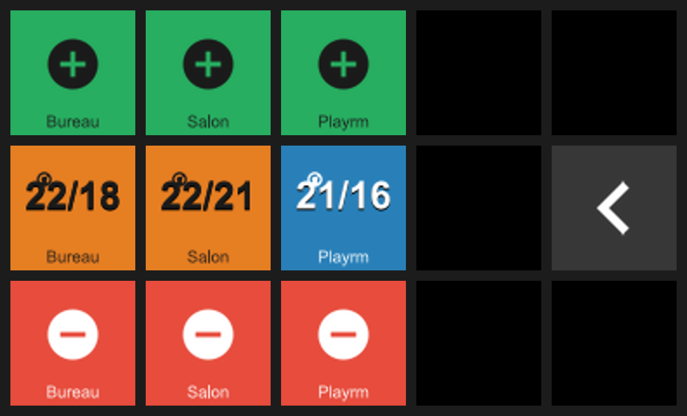

# Stream Deck Pilot — API Guide

This service is designed to be driven by Claude Code or scripts. All endpoints accept and return JSON. The OpenAPI schema is always available at `GET /openapi.json` (no auth required).

---

## Authentication

Every endpoint except `/health` and `/openapi.json` requires:

```
X-Api-Key: <value of the API_KEY environment variable>
```

Missing or wrong key → `401 Unauthorized` (a problem body with `"error": "invalid_api_key"`; see [Error reference](#error-reference)).

---

## Mental model

```
Device catalogue (app-owned, read-only via API)
  └─ DeviceEntry  serial, model, key geometry, first/last seen
        └─ DeviceConfig  (one per serial, API-managed, schemaVersion 2)
              └─ Page[]  (type discriminator: "ButtonGrid")
                    └─ ButtonDefinition[]
                          ├─ Display      icon + iconPlacement + Center/Bottom text zones
                          ├─ Inbound      MQTT topic, field extraction, staleness
                          ├─ Rules[]      ordered conditions → colour/icon override
                          └─ Gestures     "Tap" | "LongPress" | "DoubleTap" → [PublishAction | NavigateAction]
```

**Key rules:**
- You cannot write config for a serial that isn't in the catalogue. The device must have been physically connected at least once.
- Key positions (`keyIndex`) are 0-based, left-to-right, top-to-bottom. MK.2 = 0–14 (5 cols × 3 rows).
- All config writes are validated before persisting. Errors return `400` with an `errors` array.
- Every button needs `display`, `rules` and `gestures`, even when empty (`{}`, `[]`, `{}`). Omitting one is a `400`.
- Gesture names are case-sensitive: `Tap`, `LongPress` and `DoubleTap`, each optional. `tap` or `DoublePress` is a `400`.
  A Tap-only key fires on key-down. `LongPress` fires while the key is held past `Gestures__LongPressMs` (default 500); a shorter press is a `Tap` on release.
  On a key with `DoubleTap`, a second press within `Gestures__DoubleTapMs` (default 300) of the release is a `DoubleTap`; otherwise the `Tap` runs when that window closes.
- A `Publish` action needs a `topic` without the wildcards `+` or `#`; an empty or wildcard topic is a `400`. A missing `payload` publishes an empty message.
- **Rendering is what you declare, not what the data is.** The layout follows the zones you fill and the icon placement you choose — the service never infers a layout from the *kind* of data a tile carries.

---

## Display model (the important part)

A tile is composed from an optional icon plus two **text zones**. You decide what goes where; the service does not guess.

```jsonc
"display": {
  "baseIcon": "builtin:thermometer",   // "builtin:<mdi-name>" | "custom:<filename>" | null
  "iconPlacement": "corner",           // "corner" | "center"   (see below)
  "center": { "label": null,  "template": "{value} {unit}" },   // large hero text
  "bottom": { "label": "Bureau", "template": null },            // small bottom caption
  "precision": 1                       // optional: decimals for numeric {value}, 0–3
}
```

### `precision`

Optional number of decimals used for a numeric `{value}`, from `0` to `3` (anything else is
rejected on `PUT`). When set, the value always shows exactly that many decimals: with `2`, `1.2345`
shows `1.23` and `1.2` shows `1.20`. With `0`, `45.3` shows `45`. Rounding is half away from zero.
When omitted or `null`, whole numbers show no decimal (`45`) and others show one (`21.6`). Text
values are never changed.

### Text zones — `center` and `bottom`

Each zone has two fields:

- **`template`** — resolved against live MQTT data using the tokens `{value}`, `{unit}`, `{label}`.
- **`label`** — static text, rendered as-is.

Resolution rule per zone:

1. If `template` is set **and** the button has received live MQTT data → the template is filled and shown.
2. Otherwise the static `label` is shown (the fallback — there's nothing to resolve against yet).
3. A zone with only a `label` always shows that label.

This means a sensor tile shows its static caption immediately on connect and swaps the hero to live data once a message arrives — no separate placeholder needed.

Positional styling:
- **`center`** renders **large, centred** — the hero. Its text is split on the first space: the head renders big, the tail renders small beneath it as a unit. So `"{value} {unit}"` → big `23.5`, small `°C`.
- **`bottom`** renders as a **small caption** along the bottom (e.g. a room name).

### `iconPlacement`

- **`corner`** — the icon is drawn large and faint (22% opacity, slightly bigger than the key) as a watermark *behind* the value and caption, so it identifies the tile without competing with the number. Use when a value in `center` is the hero (sensor tiles). This is the default if the field is omitted.
- **`center`** — large, centred icon (the hero). Use for toggle / navigation / status tiles. If `center` text is also present, the **text wins** and the icon is not drawn.

### Icons

- `builtin:<mdi-name>` resolves any [Material Design Icons](https://pictogrammers.com/library/mdi/) glyph by name (e.g. `builtin:thermometer`, `builtin:molecule-co2`, `builtin:lightbulb`, `builtin:chevron-right`). The glyph is drawn transparent and tinted to an automatically-chosen ink colour (light or dark) for contrast against the tile background — you never set text/icon colour.
- `custom:<filename>` references an icon you uploaded via `POST /devices/{serial}/images`. `<filename>` must be a bare file name (no `/`, `\` or `..`).
- Any other form (another prefix, an empty name, a path) is rejected with `400`, for `display.baseIcon` and for a rule's `icon`.
- A small set of legacy generated tokens (`co2`, `thermometer`, `humidity`, `power`, `arrow-left`, `arrow-right`, `placeholder`, `fallback`) remain as a fallback when an MDI name is not found. Prefer MDI names. See `docs/icon-vocabulary.md`.

---

## What the tiles look like

Rendered by the actual `KeyBitmapComposer` (pixel-accurate to the hardware) — an example
layout, `main` dashboard and `climate` page:




Generated headlessly by `tools/StreamDeckPreview` from a device config; see that tool's README
to regenerate or to preview your own config without a physical deck.

---

## Endpoints

### `GET /devices`
List the device catalogue with current connection state.

```jsonc
// Response 200
[
  {
    "serial": "EXAMPLESERIAL1",
    "model": "Stream Deck MK.2 (Scissor Switch)",
    "keyRows": 3,
    "keyColumns": 5,
    "firstSeen": "2026-06-05T10:00:00Z",
    "lastSeen": "2026-06-05T12:00:00Z",
    "connectionState": "Connected"   // Unknown | Disconnected | Connecting | Connected | Faulted
  }
]
```

### `GET /devices/{serial}/status`
Connection state for one device. `404` if serial not in catalogue.

### `GET /devices/{serial}/config`
Current persisted config. `404` if no config written yet.

### `PUT /devices/{serial}/config`
Write (replace) the full config for a device. Validated before save. The body must be at the current schema version (`2`); use `POST /config/upgrade` first if you hold an older config.

```jsonc
// Request body — DeviceConfig
{
  "schemaVersion": 2,
  "serial": "EXAMPLESERIAL1",
  "pages": [
    {
      "pageType": "ButtonGrid",
      "pageId": "main",
      "buttons": [ /* ButtonDefinition[] — see below */ ]
    }
  ],
  // Optional: return to pages[0] (the home page) after this many idle seconds (0 = off for this deck).
  // Omit to use Navigation__HomeAfterInactivitySeconds (default 0, off).
  "homeAfterInactivitySeconds": 120
}
// Response 204 No Content on success
// Response 400 problem with an "errors" list on validation failure, malformed JSON, or a
//   missing list/null entry (pages, buttons, rules, gesture actions) — nothing is saved
```

On success the device's live projection is rebuilt immediately (no restart/reconnect): desired
state is rebuilt from the new config, **every key is cleared and redrawn** (removed/moved buttons
leave no ghost image), and the device **resets to the first page**.

- **`?resetPage=false`** — keep the device on its current page instead of snapping to the first
  page. The full key redraw still happens; only the page reset is suppressed. Use this for frequent
  partial updates while a user may be on another page. (If the current page no longer exists in the
  new config, it falls back to the first page regardless.)

### `POST /config/upgrade`
Migrate a config JSON from any supported schema version to the current version. Does **not** persist. Use this to bring a stored v1 config up to v2 before re-writing it.

```jsonc
// Request: any DeviceConfig JSON (any supported schemaVersion)
// Response 200: same config at current schemaVersion (2)
// Response 400 problem: body not a JSON object, or schemaVersion missing / not an integer
// Response 422 problem: { ..., "error": "unsupported_schema_version", "detail": "..." }
```

### `GET /devices/{serial}/active-page`
Which page the device is currently showing, plus the available navigation targets. `404` if no config.

```jsonc
// Response 200
{
  "serial": "EXAMPLESERIAL1",
  "activePageId": "main",
  "connected": true,
  "availablePages": ["main", "climate", "lights"]
}
```

### `POST /devices/{serial}/navigate`
Force navigation to a page without publishing an MQTT `Navigate` action — handy for testing layouts. Re-renders the whole board (so keys not bound on the target page are cleared).

```jsonc
// Request body
{ "pageId": "climate" }
// Response 200 { "serial": "...", "activePageId": "climate", "rendered": true }
//   rendered=false → page set but device offline; it will render on next connect
// Response 400 problem with "availablePages": [...]  // unknown/empty pageId
// Response 404 problem  // no config for this device
```

### `POST /devices/{serial}/force-render`
Rebuilds desired state from the persisted config and does a full clear-and-redraw of the **current**
page (no page reset) — the same projection rebuild a config `PUT` performs. Useful after editing the
config file on disk, or to recover the on-screen layout. `202 Accepted`; `404` if the serial isn't
in the catalogue, `409 Conflict` if the device isn't connected (it renders from desired state when
it reconnects).

### `POST /devices/{serial}/images`
Upload a custom icon (PNG or JPEG, max 512 KB). `multipart/form-data`.

The file name must end in `.png`, `.jpg` or `.jpeg`, **and** the content must actually be PNG or JPEG
(checked from the file header). Anything else, such as a TIFF, GIF, BMP or WebP renamed to `.png`, is
rejected.

The image may be at most **1024×1024 pixels** (read from its header; keys are 72–96 px, so there is
no benefit in more). A request body over 576 KB is refused with `413` before it is read.

Icons are decoded once and cached (shrunk to key size) until the file changes, is uploaded again or is
deleted. A file on the volume over the pixel limit renders the fallback icon instead.

```
Response 200: { "ref": "custom:my-icon.png" }
Response 400 problem: { ..., "detail": "File content is not a PNG or JPEG image." }
Response 400 problem: { ..., "detail": "Image is 4000x3000; the limit is 1024x1024 pixels." }
Response 404 problem: serial not in the catalogue (nothing is created)
Response 413 problem: { ..., "detail": "Request exceeds the 576 KB upload limit." }
```

Use `"ref"` as `display.baseIcon` in a `ButtonDefinition`.

### `GET /devices/{serial}/images` / `DELETE /devices/{serial}/images/{filename}`
List or remove custom icons.

### `GET /openapi.json`
Full OpenAPI 3 schema (no auth required).

---

## ButtonDefinition schema

```jsonc
{
  "buttonId": "office-co2",          // stable human-readable ID
  "keyIndex": 0,                     // 0-based, within page
  "pageId": "main",

  "display": {
    "baseIcon": "builtin:molecule-co2",  // "builtin:<mdi-name>" | "custom:<filename>" | null
    "iconPlacement": "corner",           // "corner" (faint watermark behind the text) | "center" (large hero)
    "center": { "label": null,  "template": "{value} {unit}" },  // large hero text
    "bottom": { "label": "CO₂",  "template": null },             // small caption
    "precision": 0                       // optional: decimals for numeric {value} (0–3); null = default
  },

  "inbound": {                       // null for press-only buttons
    "topic": "home/office/co2",      // required when inbound is set
    "valueField": "value",           // dot path into a JSON object ("temperature", "state.mode"); null = the "value" key
    "unitField": "unit",
    "labelField": null,              // optional: extracts a live string for the {label} token
    "expectsRetained": true,         // shows a dimmed placeholder until first value arrives
    "stalenessTimeout": "00:00:30"   // TimeSpan; null = never goes stale
  },
  // While the broker is down, keys with an inbound binding or a Publish tap are drawn
  // drained of colour with a broken-link marker (README "Broker outages"); nothing to configure here.

  "rules": [                         // ordered, first-match-wins, over the extracted value
    { "condition": "eq:unavailable", "backgroundColour": "#555555", "icon": null },
    { "condition": ">1000", "backgroundColour": "#FF0000", "icon": null, "blink": true },
    { "condition": ">800",  "backgroundColour": "#FF8800", "icon": null },
    { "condition": ">=0",   "backgroundColour": "#00AA00", "icon": null }
  ],
  // "backgroundColour" must be #RRGGBB (or null); other forms ("red", "#F00") are rejected on PUT.
  // A matched rule's "icon" overrides display.baseIcon for that render.
  // "blink": true (optional, default false) makes the key blink while that rule matches
  // (README "Blinking keys"). Stale and broker-offline keys don't blink.

  "gestures": {
    "Tap": [
      { "type": "Publish", "topic": "home/ventilation/toggle", "payload": "true" },
      { "type": "Navigate", "targetPageId": "menu" }
      // actions execute in order, fire-and-forget
    ]
  }
}
```

### Rule conditions

Rules are evaluated in order; the first matching condition wins. If none matches, the tile keeps its default background and `baseIcon`. Numeric and text conditions can be mixed in one list.

| Condition | Matches when the value… |
|---|---|
| `>N` `>=N` `<N` `<=N` `==N` | is a number and compares true with `N` |
| `between:A:B` | is a number with `A ≤ value ≤ B` |
| `eq:TEXT` | equals `TEXT` |
| `ne:TEXT` | does not equal `TEXT` |
| `in:A,B,C` | equals one of the comma-separated values |
| `any` | is anything (use it last as "otherwise") |

**Text matching:** both sides are trimmed and compared **case-insensitively** (`eq:on` matches `On`). Numbers are compared as the text they arrived as, so `eq:1` does not match `1.0`; use `==1` for numbers. Numeric conditions never match text, so `>=0` skips `unavailable`. Everything after `eq:`/`ne:` is the value. `in:` values can't contain a comma.

**What counts as a number:** an optional sign, digits with `.` as the decimal point, and an optional exponent (`21.5`, `-3`, `1e3`), with surrounding whitespace allowed. Commas are never accepted, as a thousands separator or as a decimal point, so `1,5` is text: numeric conditions skip it, `eq:1,5` matches it, and it's displayed as received. `NaN`, `Infinity` and values too large for a double are also text. The same rule applies to the `N`, `A` and `B` operands, so `>1,5` is rejected on `PUT`.

On/off state with a fallback:

```jsonc
"rules": [
  { "condition": "eq:on",                 "backgroundColour": "#F1C40F", "icon": "builtin:lightbulb" },
  { "condition": "in:unavailable,unknown", "backgroundColour": "#555555", "icon": null },
  { "condition": "any",                   "backgroundColour": "#222222", "icon": "builtin:lightbulb-outline" }
]
```

Conditions are validated when the config is written. A malformed or unknown condition returns `400`, naming the button and the rule number (e.g. `Button 'b1' rule 2: '==on' is not numeric — use 'eq:on' to match text.`).

### Tile recipes

| Tile | iconPlacement | center | bottom |
|------|---------------|--------|--------|
| Sensor (value hero) | `corner` | `{ template: "{value} {unit}" }` | `{ label: "Bureau" }` |
| Climate (cur/tgt) | `corner` | `{ template: "{label}" }` (live `"22/18"`) | `{ label: "Salon" }` |
| Toggle / status | `center` | — | `{ label: "Lampe" }` |
| Navigation arrow | `center` | — | — |

> Climate note: a `{label}` hero must have **no internal space** (`"22/18"`, not `"22 / 18"`), because the center text is split on the first space to separate the unit. Round to integers to keep it narrow on a 72 px key.

---

## MQTT conventions

**Inbound (sensor → button):** the payload format is auto-detected.

| Payload | Value used |
|---|---|
| `{"value": 1023, "unit": "ppm"}` | `value` (or `valueField`); `unitField`/`labelField` read from the same object |
| `23.5` | the number |
| `on` / `heat` / `unavailable` | the text, trimmed |
| `"heat"` / `true` | JSON string unquoted / `true` |
| `{"temperature": 21.5}` | `valueField` path, e.g. `temperature` or a dotted `state.mode` |

If a JSON object yields no usable value, the update is skipped and the tile keeps its last value. That happens when `valueField` is missing, or when `valueField` is `null` and there's no `value` key, and also for a `null` field, an object at the path, or a payload that is empty or literally `null` or `[]`. A warning is logged (at most once per topic every 10 minutes) and the message counts as dropped (`no_value`). Generic publishers such as Home Assistant `mqtt_statestream` (bare state text per entity topic) work directly, combined with text rules (`eq:`/`in:`).
Add a `label` field (and point `inbound.labelField` at it) when you want a live string in the `{label}` token, e.g. `{"value": 22.0, "label": "22/18"}`.
Publishers should set the **retain** flag so the app populates immediately on start.

**Outbound (button press → broker):**
`PublishAction.payload` is emitted verbatim. Choose a stable payload per button (e.g. `"true"`, `"toggle"`, or a JSON string).

**Brightness (all decks):**
Brightness is controlled over MQTT only. There is no REST endpoint for it.

| Topic | Direction | Payload |
|---|---|---|
| `home/streamdeck/brightness/set` | → app, **retained** | `0`–`100` or `{"value": n}`. Rounded and clamped. Garbage is ignored with a warning. |
| `home/streamdeck/brightness/state` | app →, retained | Level currently applied (plain integer). |

The default is 80 until a value arrives. The level is re-applied on every (re)connect. While it is 0,
a key press only wakes the deck to the last non-zero level (or 80) for `Brightness__WakeTimeoutSeconds`
(default 60). That press's gesture is not run. Topics are configurable via `Brightness__SetTopic` /
`Brightness__StateTopic`.

```bash
mosquitto_pub -h mqtt.example.com -u $MQTT_USER -P $MQTT_PASS -r \
  -t home/streamdeck/brightness/set -m 30
```

---

## Worked example: configure a CO₂ monitor button

```bash
# 1. Discover what's connected
curl -H "X-Api-Key: $API_KEY" http://streamdeck.example.com/devices

# 2. Write a config: a CO₂ sensor tile on key 0 (value hero + room caption)
#    and a nav arrow on key 14.
curl -X PUT \
  -H "X-Api-Key: $API_KEY" \
  -H "Content-Type: application/json" \
  -d '{
    "schemaVersion": 2,
    "serial": "EXAMPLESERIAL1",
    "pages": [{
      "pageType": "ButtonGrid",
      "pageId": "main",
      "buttons": [
        {
          "buttonId": "co2",
          "keyIndex": 0,
          "pageId": "main",
          "display": {
            "baseIcon": "builtin:molecule-co2",
            "iconPlacement": "corner",
            "center": { "template": "{value} {unit}" },
            "bottom": { "label": "Bureau" }
          },
          "inbound": { "topic": "home/office/co2", "valueField": "value", "unitField": "unit", "expectsRetained": true, "stalenessTimeout": "00:01:00" },
          "rules": [
            { "condition": ">1000", "backgroundColour": "#E74C3C", "icon": null },
            { "condition": ">700",  "backgroundColour": "#E67E22", "icon": null },
            { "condition": ">=0",   "backgroundColour": "#27AE60", "icon": null }
          ],
          "gestures": {}
        },
        {
          "buttonId": "to-climate",
          "keyIndex": 14,
          "pageId": "main",
          "display": { "baseIcon": "builtin:chevron-right", "iconPlacement": "center" },
          "rules": [],
          "gestures": { "Tap": [ { "type": "Navigate", "targetPageId": "climate" } ] }
        }
      ]
    }]
  }' \
  http://streamdeck.example.com/devices/EXAMPLESERIAL1/config

# 3. Force a re-render immediately
curl -X POST -H "X-Api-Key: $API_KEY" \
  http://streamdeck.example.com/devices/EXAMPLESERIAL1/force-render

# 4. Verify MQTT is updating the button — publish a test value
mosquitto_pub -h mqtt.example.com -u $MQTT_USER -P $MQTT_PASS \
  -r -t home/office/co2 -m '{"value":850,"unit":"ppm"}'
```

---

## Schema versions & migration

- Configs carry a `schemaVersion`. The current version is **2**.
- Stored configs below current are migrated **automatically on load**, and on demand via `POST /config/upgrade`. Below the minimum supported version → `422`.
- **v1 → v2** mapping (for reference — happens automatically):
  - `display.formatTemplate` → `display.center.template`
  - `display.staticLabel` → `display.bottom.label`
  - `display.baseIcon` → unchanged
  - `display.iconPlacement` → `"corner"` if the tile had a `formatTemplate` (was a sensor), else `"center"` — reproducing the v1 look exactly.

---

## Error reference

Every error is an [RFC 7807](https://www.rfc-editor.org/rfc/rfc7807) problem, served as
`application/problem+json`:

```jsonc
{
  "type": "https://tools.ietf.org/html/rfc9110#section-15.5.1",
  "title": "Invalid configuration",
  "status": 400,
  "detail": "Button 'power': rules is required (use [] for none). (and 1 more)",
  "errors": ["Button 'power': rules is required (use [] for none).", "..."]
}
```

`status`, `title` and `type` are always present; `detail` explains this occurrence. Extra members:
`errors` (every validation message) on config validation failures, `error` (a stable code:
`invalid_api_key`, `unsupported_schema_version`) where clients branch on it, and `availablePages` on
navigate. An unexpected server error is a `500` problem with no exception details.

| Code | Meaning |
|------|---------|
| 400 | Validation error or malformed body (`errors` on config writes), bad/unknown `pageId` on navigate, bad upload |
| 401 | Missing or wrong `X-Api-Key` |
| 404 | Serial not in catalogue, no config for that serial, unknown image, unknown route |
| 409 | `force-render` while the device isn't connected |
| 422 | Schema version too old for `POST /config/upgrade` |
| 500 | Unexpected server error (logged; no details in the response) |
| 204 | Config saved successfully (`PUT /devices/.../config`) |
